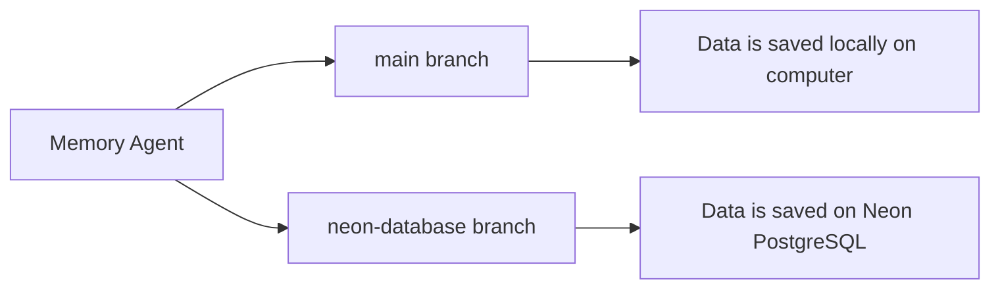

# MemoryAgent
This project was made while I'm interning as Software Engineer @Jindal Steel.

It's a Chatbot that fetches and save memories, facts, user preferences while you chat and store them locally on your PC or on a online database _(depending on it's type)_ and re-fetches again as needed to give more personalized outputs to you. 

Just like ChatGPT, Claude and Gemini uses Memory Feature.

- Language used `Python`
- LLM Model used `gpt-oss-120b` and `gpt-oss-20b`


## Branches

> This project has 2 branches:



This project has multiple branches, each with a different approach to storing data with extra features

| Branch | Data storage | Status |
|--------|--------------|--------|
| `main` | Locally on your PC | Stable, original version |
| `neon-db` | Online database (Neon) | Stable |
| `v3` | Online database + extra features + bug fixes | In development |

### `main`: Local storage
The original, fully working version. All data is saved locally on your computer, so it needs no database setup or internet connection.

### `neon-db`: Online database
Same functionality as `main`, but data is stored in a Neon (PostgreSQL) database online. This means your data isn't tied to one machine and can be accessed from anywhere.

### `v3`: Enhanced version (in progress)
Builds on the online database version with additional features:
- **PIN per profile**: each profile is protected by its own PIN
- **Better chat privacy**: improved protection for chat data
- More features to come

To switch branches:
```bash
git checkout <branch-name>
```
