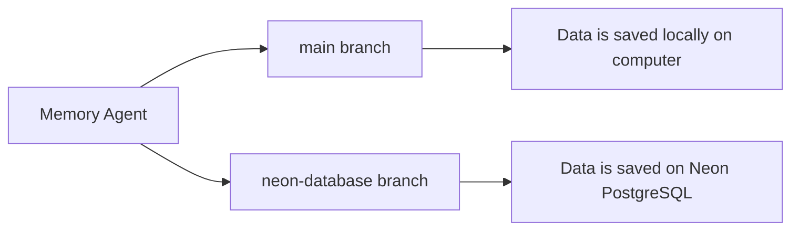

# MemoryAgent
This project was made while I'm interning as Software Engineer @Jindal Steel.

It's a Chatbot that fetches and save memories, facts, user preferences while you chat and store them locally on your PC or on a online database _(depending on it's type)_ and re-fetches again as needed to give more personalized outputs to you. 

Just like ChatGPT, Claude and Gemini uses Memory Feature.

- Language used `Python`
- LLM Model used `gpt-oss-120b` and `gpt-oss-20b`

> This project has 2 branches:

