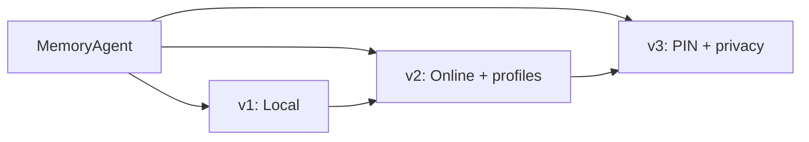

# MemoryAgent

A chatbot that **remembers you**. While you chat, it picks out facts and preferences worth keeping, saves them, and brings the relevant ones back in later replies so its answers feel personal. It works like the Memory feature in ChatGPT, Claude and Gemini.

Built while interning as a Software Engineer @ Jindal Steel.

- **Language:** Python
- **UI:** Streamlit (browser)
- **LLMs:** `gpt-oss-120b` (chat) and `gpt-oss-20b` (memory extraction), served through the Groq API
- **Embeddings:** `BAAI/bge-small-en-v1.5` via `fastembed`, runs locally on your machine

## Versions

The project has three versions, each in its own branch. Every version builds on the one before it.



| | `v1` | `v2` | `v3` |
|---|:---:|:---:|:---:|
| **Where memories are stored** | SQLite file on your PC | Neon (PostgreSQL) | Neon (PostgreSQL) |
| **Status** | Stable | Stable | Stable |
| Terminal chat (`main.py`) | ✅ | ❌ | ❌ |
| Browser chat (Streamlit) | Basic | iOS-Messages style UI | iOS-Messages style UI |
| Multiple profiles ("Who's using?" screen) | ❌ | ✅ | ✅ |
| Memories page (edit, delete, restore) | ❌ | ✅ | ✅ |
| Keeps old versions of a memory | ❌ (overwrites) | ✅ | ✅ |
| Friends: linked profiles, "told by" facts | ❌ | ✅ | ✅ |
| Streaming replies and auto chat titles | ❌ | ✅ | ✅ |
| PIN per profile | ❌ | ❌ | ✅ |
| "Forget that…" from the chat | ❌ | ❌ | ✅ |
| Things you tell about others stay private | ❌ | ❌ | ✅ |

### `v1`: Local storage
The original version. Memories are saved in a local SQLite file (`memory.db`), so there is **no database to set up**. It still needs internet for the LLM API (and once, to download the embedding model).

- One user, chat in the terminal (`python main.py`) or a simple browser page
- Extracts facts after each reply and skips duplicates by comparing meaning (embeddings)
- A newer fact simply overwrites the closest old one

### `v2`: Online database + profiles
Same idea as `v1`, but memories live in a Neon database, so they aren't tied to one computer. Much smarter memory handling:

- **Profiles:** everyone picks or creates their own profile, and each has separate memories
- **Better extraction:** a *reconciler* decides for every new fact whether to **ADD**, **UPDATE**, **NOOP** or **DELETE**, and facts are checked so the model can't invent details
- **Nothing is lost by accident:** updates keep the old version, and you can restore it from History
- **Friends:** say "Aman is my friend" and the profiles are linked. What you say about Aman is saved to his profile, tagged "told by you". With his permission, friends can share facts about themselves (never health details)
- **Memories page** to review, edit, delete and restore memories
- Faster: replies stream in, and memory saving runs in the background

### `v3`: PIN + privacy
Builds on `v2`:

- **PIN per profile:** an optional 4-digit PIN to open, edit or delete a profile. It is stored as a salted hash, and 5 wrong tries lock the profile for 5 minutes. Only the unlocked profile's chats and memories are shown
- **Gossip stays private:** things you tell the bot about other people are hidden from them by default. You can choose, per memory, to let that person see it (Memories page → "Things you told me about others")
- **"Forget that…":** just tell the chat to forget something. It finds the matching memory and deletes it (restorable from History). It never deletes more than 5 at once, and "forget everything" points you to the Memories page
- **Safer sharing:** facts that mention another profile are kept out of friend-sharing
- **Smarter, shorter replies:** a rewritten system prompt with less filler
- Existing `v2` data is upgraded automatically, with no reset needed

> **Note:** the PIN is a lock inside the app, not encryption. Anyone with direct access to the database can still read the memories. Forgot a PIN? Run `python reset_pin.py "Name"`.

## Getting started

```bash
git checkout v2          # or v1 / v3
pip install -r requirements.txt
```

Create a `.env` file in the project folder:

```env
GROQ_API_KEY=your_groq_key
CHAT_MODEL=openai/gpt-oss-120b
EXTRACTOR_MODEL=openai/gpt-oss-20b

# v2 and v3 only: your Neon connection string
DATABASE_URL=postgresql://...
```

If the model names are left out, the code falls back to `llama-3.3-70b-versatile` and `llama-3.1-8b-instant`.

Run it:

```bash
streamlit run streamlit_app.py     # all versions
python main.py                     # v1 only: terminal chat
```

> Chats are kept only while the page is open. Memories and profiles are what get saved.

## Useful scripts (v2 and v3)

| Script | What it does |
|---|---|
| `reset_db.py` | Wipes all profiles and memories so you can start fresh (asks you to type `RESET`) |
| `reset_pin.py` (v3) | Removes the PIN from one profile |

## Project layout

| File | Role |
|---|---|
| `streamlit_app.py` | The chat interface |
| `agent.py` | Builds the prompt and gets the reply |
| `extractor.py` | Picks out facts worth remembering |
| `reconciler.py` (v2+) | Decides add / update / ignore / delete |
| `store.py` / `db.py` | Saving and reading memories |
| `retriever.py` | Finds the memories relevant to your message |
| `embeddings.py` | Turns text into vectors (local model) |
| `forget.py`, `pins.py` (v3) | Forget-from-chat and PIN hashing |
